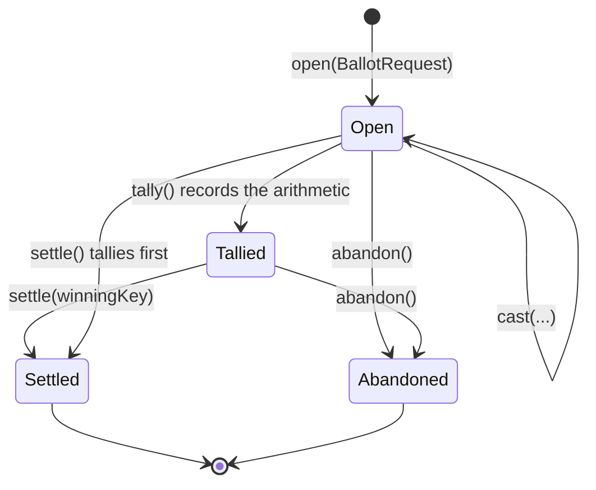

# Ballot

> A decision someone deferred, settled once it concludes. A steward opens a ballot over a list of candidates,
> members approve the ones they would accept, and on the deadline the winner is handed back to whoever opened it.
> Inert until a consumer opens a ballot: the module ships none of its own, and where none is open nothing is shown,
> which is why it needs no enable flag. Built and guarded as described in [modules/README.md](../README.md).

## Counting, then deciding, are two steps

Tallying records a single winner or the set of tied keys; settling is a separate call. The split exists because
**a tie has no arithmetic answer**, and a tallied ballot has to be able to sit undecided without losing its numbers.
`settle()` on a still-open ballot tallies first, so the arithmetic is always on record before a winner is committed.

Two rules protect a count from its voters: casting **replaces** a member's previous approvals rather than adding to
them, and a selection is **intersected with the ballot's own option keys**, so a forged key cannot enter a tally.

Zero votes is reported as undecided, not as every candidate being tied. The deadline task needs to tell an empty
ballot from a genuine deadlock.

## It counts, it does not interpret

Everything that varies between one kind of decision and another is answered by the consumer.

| Question                       | Answered by                                                      |
|--------------------------------|------------------------------------------------------------------|
| What are the candidates?       | the caller, when it opens the ballot                             |
| How long is it open?           | the caller, as a deadline on the request                         |
| Approve many, or pick one?     | `TallyMode` on the request                                       |
| Settled by a person or a task? | `SettlementMode` on the request                                  |
| Who may vote?                  | `ElectorateProviderInterface`, matched on the purpose            |
| What does winning *mean*?      | `SettlementListenerInterface`, matched on the purpose            |
| Who may see it?                | `VisibilityFilterInterface`, an AND-intersection over ballot ids |
| Where is it voted on?          | `PageProviderInterface`, matched on the purpose                  |

- **A candidate is a key, not a row.** `Candidate` carries an opaque key chosen by the opener plus a display label.
  One ballot's options can come from a curated list and another's be typed in by hand, because the module never
  resolves a key: it counts them and hands the winner back.
- **A subject is a `(type, id)` pair, not a foreign key.** `BallotSubject` says what the decision is *for*, and it is
  nullable because a decision need not attach to anything. The only foreign key the module holds into the rest of
  the application is the voter on `mod_ballot_vote`.
- **`purpose` is the routing key** all four seams match on. Consumers namespace theirs.
- **The title is opaque too.** `BallotRequest::$title` is an optional pre-translated heading, stored and echoed like a
  candidate label; without one the page falls back to the tally mode's label.

## Visibility and electorate are separate questions

`view()` gates on visibility alone, so a member who was never entitled to vote can still read a decided result.
`listOpenFor()` and `countOpenFor()` gate on both, because they answer "what can I still vote in".

## A ballot is scoped by whoever can answer for it

A ballot carries a purpose, an optional subject and its candidate keys, and which of those says where the ballot
belongs depends on the ballot. Visibility filters split along that line rather than by who wrote them.

- **A ballot with a subject is judged through its subject.** The application's `App\Event\BallotVisibility` claims
  every ballot whose subject is an event and makes it visible exactly where the event is, through
  `EventFilterService::isEventAccessible()`. Anything that narrows events therefore narrows their ballots with no
  ballot logic of its own. For a batch with no event subject it returns `null` and stays out of the decision.
- **A ballot with no subject has only its candidates.** A filter that scopes item rows judges it from the candidate
  keys, and should require *every* candidate to be visible rather than any, so one shared item cannot hand a viewer
  a ballot that is about someone else's rows.
- **A subjectless ballot's purpose opens with its candidates' item type**, before the first dot: the photos plugin's
  `ContestService::PURPOSE` is a ballot over photos. That convention is the only link from a purpose to a set of rows
  a filter can scope, and it is a convention rather than a field because the module routes on purposes and never
  interprets them. A filter claims a prefix only for an item type it actually scopes; an unknown prefix means *no
  opinion*, not *hidden*.
- **The seam hands filters the data, not just ids.** `narrowVisibleBallotIds()` is called once per purpose with a
  list of `BallotScope` values - id, purpose, subject and candidate keys - because a filter given ids alone would
  have to read the module's tables to learn what a ballot is about, and the perimeter forbids exactly that.

A ballot the chain refuses does not exist for that viewer: `view()` returns `null`, so `/ballots/{id}` and its vote
action answer 404.

## The deadline settles only what arithmetic can

The task `ballot.settle-due` (see [modules/task/README.md](../task/README.md)) tallies every ballot past its deadline
and settles **only** those whose `SettlementMode` is `Automatic` and whose tally has a single winner. A tie, or a
ballot marked `Confirmed`, is left for a person. Failures are per ballot: one broken ballot is logged and the batch
continues.

Members hear about ballots they can still vote in through the application's notification bell. Telling them about a
*settlement* is the consumer's job, through `SettlementListenerInterface`, because only the consumer knows what
actually changed.

## The contract

`Module\Ballot\Contract\BallotInterface` is the facade: open, cast, tally, settle, abandon, view, the lists by
viewer, subject and purpose, and moving data. The four seams are `#[AutoconfigureTag]`ed and resolved inside the
module.

| Chain shape                                 | Seam                          | With nothing registered  |
|---------------------------------------------|-------------------------------|--------------------------|
| first match on the purpose, by priority     | `SettlementListenerInterface` | settles, writes nothing  |
| first match on the purpose                  | `ElectorateProviderInterface` | any authenticated member |
| first match on the purpose                  | `PageProviderInterface`       | the module's own page    |
| AND (`null` = no opinion, `[]` = block all) | `VisibilityFilterInterface`   | everything visible       |

A ballot whose purpose nobody claims settles and writes nothing: the arithmetic is still true, there is simply
nobody who wanted the answer.

`BallotOutcome` carries **both** user ids: `settledByUserId`, null when the deadline task settled it, and
`openedByUserId`, which never is. A listener whose write is permissioned writes as the opener without calling back
into the module to find out who asked.

The contract speaks in scalars, enums and readonly value objects: `BallotRequest`, `Candidate`, `BallotSubject`,
`BallotScope`, `BallotOutcome`, `BallotView`, `PortableBallot`, and the `TallyMode`, `SettlementMode` and
`BallotStatus` enums.

## Surfaces

- **Routes** - `app_ballot_index` (`/ballots`, every open ballot the viewer may vote in), `app_ballot_show` and
  `app_ballot_vote`. For a purpose a `PageProviderInterface` claims, the list links to the claimed URL and
  `/ballots/{id}` redirects there; for any other it renders the labels as text.
- **Bell** - `Internal\Notification\OpenBallotNotificationProvider` lists ballots the viewer can still vote in, and
  links to the list.
- **Task** - `ballot.settle-due`.

The outbound permit list in `mago.toml` names every core class the module reaches for, each with its reason.

## Moving data between instances

`exportAll()` and `restore()` serve data movers only. The first returns every ballot with its options, votes and
outcome, regardless of visibility; the second writes one back exactly as given. It never tallies and never calls a
settlement listener, so a settled ballot keeps its recorded outcome even when some of its votes stayed behind. The
application's archive section is the one caller, and it decides per purpose which ballots and votes leave.

## Becoming a consumer

1. Inject `BallotInterface` and call `open()` with a `BallotRequest`: a namespaced purpose, at least two distinct
   candidates, a deadline, and the opener's user id.
2. Implement `SettlementListenerInterface` for that purpose. Its `settled()` is where the winning key becomes a real
   change in your own system.
3. Implement `ElectorateProviderInterface` if the decision is not open to every member, and
   `VisibilityFilterInterface` if not every member may even see it.
4. Decide whose page members vote on (below).
5. Prove your listener through `cast()` and `settle()`: that the winning key becomes the right change, and that a
   tie changes nothing. There is no public way to make a ballot due - `cast()` requires a future deadline, and moving
   one needs the module's own tables - so the step from a passed deadline to those calls is covered once, by
   `modules/ballot/tests/Functional/DeadlineTest.php`, and needs no second proof per consumer.

The proposal module's field ballot (`modules/proposal/change.md`) is the reference: one candidate per competing value
proposed for a field plus one for leaving it alone, and a settlement that writes the winner through the change tool. It is
also why `Confirmed` earns its place beside `Automatic`: that consumer's write is permission-checked against the
current request's user, so nothing the deadline task attempted on its behalf would be allowed through.

### Use the module's page, or keep your own

Consumers split on one question: **do members need to look at the candidates, or only read them?**

|                | The module's page                  | Your own page                                                         |
|----------------|------------------------------------|-----------------------------------------------------------------------|
| Candidates are | strings a member can read          | rows a member has to see - posters, photos, dishes                    |
| You implement  | the seams you need                 | the seams you need, `PageProviderInterface`, a controller, a template |
| You call       | `open()`                           | `open()`, then `view()` to render and `cast()` to record              |
| Example        | the proposal module's field ballot | `App\Item\Ballot\Page`, `Plugin\Photos\Service\ContestService`        |

The module renders `Candidate::$label` as plain text. Teaching it to resolve a key into a picture would make it
interpret its candidates, so a consumer whose ballot is a wall of film posters keeps its own page and drives this
contract from it - the module still owns the decision, the arithmetic and the other seams. **Claim that page with a
`PageProviderInterface`, or members arriving from the bell still land on the text one.**
`templates/_components/ballot_tiles.html.twig` is the shared tile grid those pages render.
