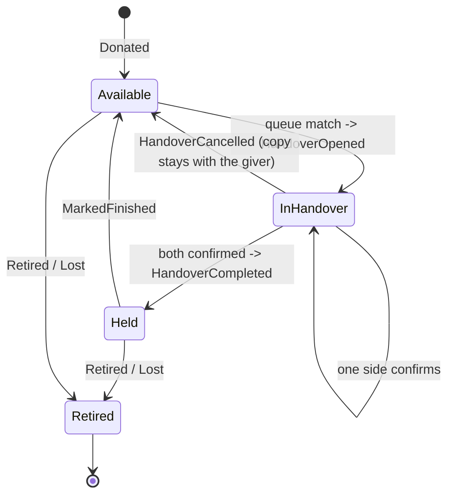

# Circulation

> Physical copies of an item travelling between members: who donated one, who holds it now, who is queued for it,
> and every move it ever made. Every row is keyed by `(itemType, itemId)`, so the module carries the whole system
> without knowing what a book is. Inert until a plugin switches an item type on: with no participation provider
> saying yes, no badge, panel or dashboard appears. Built and guarded as described in
> [modules/README.md](../README.md).

## A copy moves only when both sides confirm

Implement nothing beyond this; the unit tests assert it. Two things the diagram encodes are easy to get wrong:

- **`holder` and `status` answer different questions.** `holder` is where the object physically is; `Available`
  means it is up for grabs. A donor holds their own copy from the moment they add it, and a member who marks a copy
  finished keeps holding it until a handover completes.
- **A cancelled handover returns the copy to `Available` and the requester to `Waiting`.** It does not re-offer
  immediately - that would hand it straight back to the person who just cancelled. The maintenance task re-matches
  free copies to waiting queues.

Confirming is idempotent per side and completes only on the second *distinct* side; a handover whose giver's account
was deleted completes on the receiver alone.

The chat on the handover page is the application's comment section under `CirculationInterface::COMMENT_TARGET`,
made a **private** target: only the two participants may comment, and only while the handover is open. The page
itself is open to the participants and to stewards whose scope holds the copy - the same scope that gates retiring a
copy. Handover chat never reaches the activity log.

## The ledger is the truth; the holder is a cache of it

A copy is one physical object, a request a place in a waiting list, a handover a live two-sided negotiation - all
working state. The ledger is append-only history: `LedgerService::append()` is its only writer, and a mistake is
corrected by appending. Each entry carries when the move happened and when it was recorded, which diverge whenever a
confirmation lands late.

The copy's holder, holding date and status exist so a list page does not replay history, and they must always be
reproducible from the ledger. The rebuild is the standing proof: report-only it lists the copies that drifted,
otherwise it rewrites their derived columns, and a copy with no ledger entry is named but never touched. It is the
`circulation-rebuild` action on the Maintenance page and `app:circulation:rebuild` on the command line, which exits
non-zero on drift.

## The waiting list is per title, not per copy

A member requests *the item*, and the module matches them to whichever copy frees up first - that is what makes
"there are three copies of this one" work at all. A member holds one place per title, enforced by a unique index that binds only on open requests.

## A context is opaque, and visibility is not the module's

`ContextProviderInterface` mints an opaque string that the module never parses. The internal
`DefaultContextProvider` returns the item type key at the lowest priority, so a standalone install has one shelf per
type; a plugin may split shelves by any key it likes, and two shelves stay apart even when both reference the same
item row.

Visibility rides the application's item filter chain: every read narrows through `App\Item\FilterService` first, so
a copy of an item the serving host hides is never returned. Item deletion arrives on the application's item action
chain: `Internal\ItemDeletionHandler` cancels open requests and handovers, retires the copies and appends `Retired`
entries, so the history survives while the live rows stop pointing at a dead item.

`EligibilityProviderInterface` is consulted in the *request* path, not at handover time, so somebody below a bar is
told why before they ever join the queue. That is why its verdict is an `EligibilityVerdict` carrying a translation
key and parameters rather than a bare bool.

## Trust is optional and runs one way

`Internal\Trust\` implements the [Trust module's](../trust/README.md) contract; circulation depends on Trust, never
the reverse. It stays inert unless a consumer switches it on.

- `ContextIndex` is the single answer to "is this context one circulation owns". Nothing else parses a context.
- `LedgerActionSource` declares the handover and donation actions and replays the ledger for them. A completed
  handover rewards **both** sides; one with no giver rewards the receiver alone.
- `ParticipationEligibilityProvider` plugs the trust minimum into the eligibility chain and names the shortfall in
  its refusal.

## The contract

Everything outside the module talks to `Module\Circulation\Contract\`. Every seam is `#[AutoconfigureTag]`ed and
resolved inside the module.

| Chain shape                      | Seam                             | Answers                                |
|----------------------------------|----------------------------------|----------------------------------------|
| first non-null wins              | `ParticipationProviderInterface` | does this item type circulate now      |
| first non-null wins, by priority | `ContextProviderInterface`       | which shelf a row belongs to           |
| first non-null wins              | `TrustEnabledProviderInterface`  | is this item type's circulation scored |
| AND, `null` abstains             | `EligibilityProviderInterface`   | may this member join this waiting list |
| union, by priority               | `DashboardTabInterface`          | one more tab on the dashboard          |

`CirculationInterface` is the one injectable facade: contexts, and moving shelves between instances. The enums are
the states in the diagram. `EligibilityProviderInterface` has no default implementation.

## Surfaces

- **Twig** - the `circulation_*` functions place the badge, the panel and the dashboard link. All return nothing when
  the participation chain says the type is off, so a plugin template calls them unconditionally.
  `circulation_warm(itemType, itemIds)` is the N+1 guard: a list page calls it once before its loop, and every later
  badge reads a per-request memo.
- **Dashboard** - one per item type, 404 when the type does not circulate. **About me** is Stats narrowed to the
  viewer within the serving context, with a trust explanation when trust is on. Anything else registers a
  `DashboardTabInterface`.
- **Handover page** - every mutation is POST + CSRF, validated before any entity lookup.
- **Task** - `circulation-maintenance` (see [modules/task/README.md](../task/README.md)) expires stale offers, closes
  handovers left open too long (`QueueService::OFFER_WINDOW_DAYS`, `MaintenanceTask::CLOSE_AFTER_DAYS`) and
  re-matches free copies against waiting queues. The bell entries for an unconfirmed handover and an unread handover
  message are derived on read, so the nudge needs no work of its own.

## Moving data between instances

`CirculationInterface::export()` and `restore()` serve data movers only. `export(contexts)` returns every row of
those shelves as a `PortableShelf`, visibility ignored; `restore()` writes a shelf back exactly as given, without
matching queues, logging activity or notifying anyone.

Rows point at each other by ref: on export a row's id, on restore any number the caller chose, unique per row kind.
`restore()` returns the new id of every handover so the caller can re-attach the handover chat; a ref the shelf does
not carry resolves to null, and a handover whose copy is missing is skipped.

The application's archive section is the one production caller. It decides which rows leave, and files restored rows
under the importing instance's own context.

`purge(contexts)` deletes every copy, request, handover and ledger entry of those shelves, for a clean import.

## Becoming a consumer

1. Implement `ParticipationProviderInterface` for your item type and answer from your own settings.
2. Call `circulation_warm()`, `circulation_badge()` and `circulation_panel()` from your templates.
3. Optionally implement `TrustEnabledProviderInterface`, `EligibilityProviderInterface` or
   `DashboardTabInterface`. A consumer with its own trust switch answers `isTrustEnabled()` with the AND of that
   switch and its circulation switch, so trust scoring is on only while the type also circulates and a trust
   setting left on cannot score a type whose circulation is off.
4. Implement `ContextProviderInterface` only if one shelf per item type is not what you want.

The books plugin is the reference: `plugins/books/src/Circulation/` holds its two providers, and its
`Config::isTrustActive()` is the AND from step 3. `modules/circulation/tests/Stub/` is the smallest stand-in consumer.
