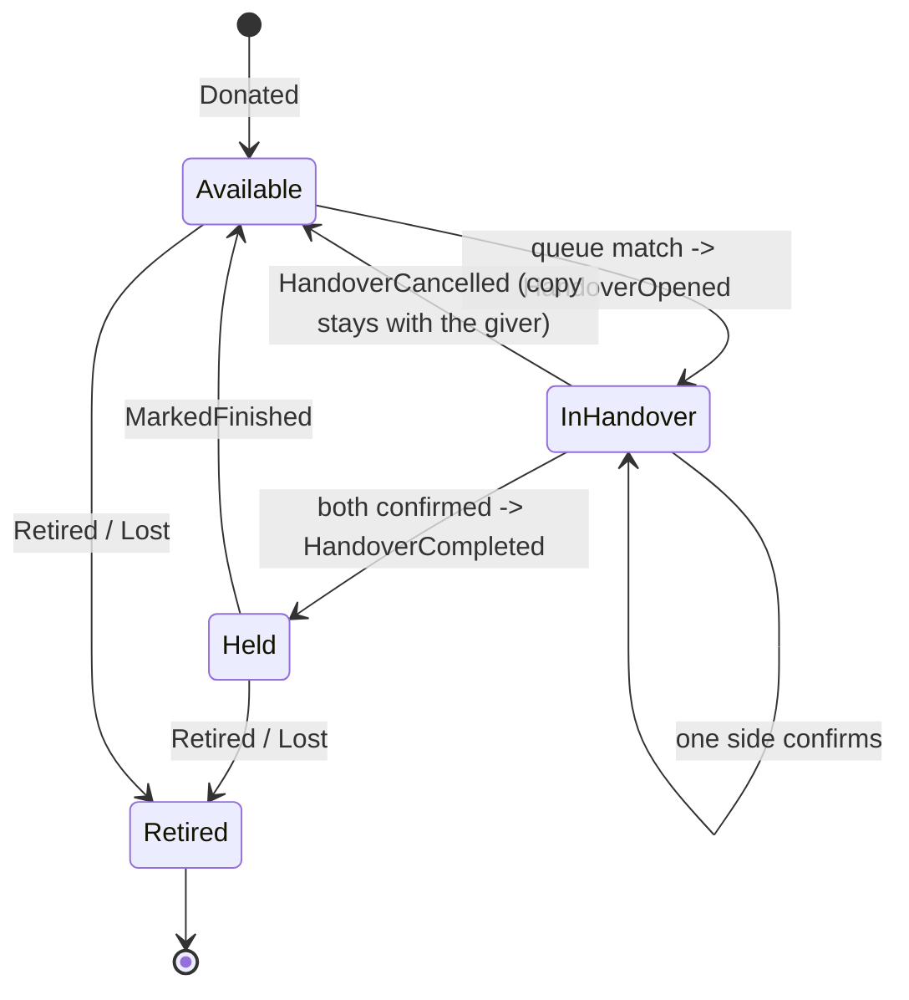

# Circulation

> Physical copies of an item travelling between members: who donated one, who holds it now, who is queued for it,
> and every move it ever made. Every row is keyed by `(itemType, itemId)`, so the module carries the whole system
> without knowing what a book is. Inert until a plugin switches an item type on: with no participation provider
> saying yes, no badge, panel or dashboard appears. Built and guarded as described in
> [modules/README.md](../README.md).

## A copy moves only when both sides confirm

Implement nothing beyond this; the unit tests assert it. Two things the diagram encodes are easy to get wrong:

- **`holder` and `status` answer different questions.** `holder` is where the object physically is; `Available`
  means it is up for grabs. A donor holds their own copy from the moment they add it, and a member who marks a copy
  finished keeps holding it until a handover completes.
- **A cancelled handover returns the copy to `Available` and the requester to `Waiting`.** It does not re-offer
  immediately - that would hand it straight back to the person who just cancelled. The maintenance task re-matches
  free copies to waiting queues.

`HandoverService::confirm()` is idempotent per side, completes only on the second *distinct* side, and refuses a
non-participant. A handover whose giver is `null` - the account was deleted - completes on the receiver alone.

The chat on the handover page is the application's comment section under the target type
`CirculationInterface::COMMENT_TARGET`, made a **private** target by `Internal\Comment\HandoverTargetProvider`:
only the two participants may comment, and only while the handover is `Open`; the page itself is gated to
participants plus stewards. Handover chat never reaches the activity log, and the bell entry for an unread message
is derived on read through `CommentService::isUnreadBy()`.

## The ledger is the truth; the holder is a cache of it

`mod_circulation_copy` is one physical object, `mod_circulation_request` a place in a waiting list,
`mod_circulation_handover` a live two-sided negotiation, and `mod_circulation_ledger` append-only history. The first
three are working state. The ledger is not: `Internal\Entity\LedgerEntry` has no setters, `LedgerService::append()`
is its only writer, and a mistake is corrected by appending. Each entry carries `occurredAt` and `recordedAt`, which
diverge whenever a confirmation lands late.

The copy's `holder`, `heldSince` and status exist so a list page does not replay history, and they must always be
reproducible from the ledger. `LedgerReplay` is that replay, and `app:circulation:rebuild` is the standing proof:
with `--dry-run` it reports drift and exits non-zero, without it the derived columns are rewritten.

## The waiting list is per title, not per copy

A member requests *the item*, and the module matches them to whichever copy frees up first - that is what makes
"there are three copies of this one" work at all. A member holds one place per title, enforced by a unique index
over `(context, item_type, item_id, user_id, open_slot)`: `open_slot` is `1` while the request is `Waiting` or
`Offered` and `null` once it closes, and a unique index treats rows with a NULL as distinct, so the constraint binds
on exactly the open rows.

## A context is opaque, and visibility is not the module's

`ContextProviderInterface` mints an opaque string that the module never parses. The internal
`DefaultContextProvider` returns the item type key at the lowest priority, so a standalone install has one shelf per
type; a plugin may split shelves by any key it likes, and two shelves stay apart even when both reference the same
item row.

Visibility rides the application's item filter chain: every read narrows through `App\Item\FilterService` first, so
a copy of an item the serving host hides is never returned. Item deletion arrives on the application's item action
chain: `Internal\ItemDeletionHandler` cancels open requests and handovers, retires the copies and appends `Retired`
entries, so the history survives while the live rows stop pointing at a dead item.

`EligibilityProviderInterface` is consulted in the *request* path, not at handover time, so somebody below a bar is
told why before they ever join the queue. That is why its verdict is an `EligibilityVerdict` carrying a translation
key and parameters rather than a bare bool.

## Trust is optional and runs one way

`Internal\Trust\` implements the [Trust module's](../trust/README.md) contract; circulation depends on Trust, never
the reverse. It stays inert unless a consumer switches it on.

- `ContextIndex` is the single answer to "is this context one circulation owns": the currently resolved context per
  trust-enabled item type, unioned with every context found on existing copies. Nothing else parses a context.
- `LedgerActionSource` declares `circulation_handover_completed` and `circulation_donation`, with points from its
  `HANDOVER_POINTS` and `DONATION_POINTS`, and replays the ledger for them. A completed handover rewards **both**
  sides; one with no giver rewards the receiver alone.
- `ParticipationEligibilityProvider` plugs the trust minimum into the eligibility chain and names the shortfall in
  its refusal.

## The contract

Everything outside the module talks to `Module\Circulation\Contract\`. Every seam is `#[AutoconfigureTag]`ed and
resolved inside the module.

| Chain shape                      | Seam                             | Answers                                |
|----------------------------------|----------------------------------|----------------------------------------|
| first non-null wins              | `ParticipationProviderInterface` | does this item type circulate now      |
| first non-null wins, by priority | `ContextProviderInterface`       | which shelf a row belongs to           |
| first non-null wins              | `TrustEnabledProviderInterface`  | is this item type's circulation scored |
| AND, `null` abstains             | `EligibilityProviderInterface`   | may this member join this waiting list |
| union, by priority               | `DashboardTabInterface`          | one more tab on the dashboard          |

`CirculationInterface` is the one injectable facade: contexts, and moving shelves between instances. The enums
(`CopyStatus`, `RequestStatus`, ...) are the states in the diagram; `PortableShelf` and its row value objects carry a
shelf for export and restore. Every member receives a user as an `int $userId`. `EligibilityProviderInterface` has
no default implementation.

## Surfaces

- **Twig** - `circulation_enabled()`, `circulation_warm()`, `circulation_badge()`, `circulation_panel()` and
  `circulation_dashboard_url()`. All return nothing when the participation chain says the type is off, so a plugin
  template calls them unconditionally. `circulation_warm(itemType, itemIds)` is the N+1 guard: a list page calls it
  once before its loop, and every later badge reads a per-request memo.
- **Dashboard** - `app_circulation_dashboard` (`/circulation/{itemType}`), 404 when the type does not circulate.
  `DashboardService` renders the built-in tabs; **About me** is Stats narrowed to the viewer within the serving
  context, with a `trust_explanation()` sidebar when trust is on. Anything else registers a `DashboardTabInterface`.
- **Handover page** - `app_circulation_handover`. Every mutation is POST + CSRF, validated before any entity lookup.
  Routes are named `app_circulation_*`, templates live under `@Circulation/`.
- **Task** - `circulation-maintenance` (`Internal\Cron\MaintenanceTask`, on a message worker, see
  [modules/task/README.md](../task/README.md)) expires offers older than `QueueService::OFFER_WINDOW_DAYS`, closes
  handovers open longer than `MaintenanceTask::CLOSE_AFTER_DAYS`, re-matches free copies against waiting queues, and
  counts the handovers waiting on a confirmation. The nudge needs no work of its own: the bell entry for an
  unconfirmed handover is derived live by `Internal\Notification\NotificationProvider`.

The outbound permit list in `mago.toml` names every core class the module reaches for, each with its reason.

## Moving data between instances

`CirculationInterface::export()` and `restore()` serve data movers only. `export(contexts)` returns every row of
those shelves as a `PortableShelf`, visibility ignored; `restore()` writes a shelf back exactly as given, without
matching queues, logging activity or notifying anyone.

Rows point at each other by ref. On export a ref is the row's id; on restore it is any number the caller chose,
unique per row kind, and `restore()` returns the new id of every handover so the caller can re-attach the handover
chat. A ref the shelf does not carry resolves to null, and a handover whose copy is missing is skipped. The ledger's
pointer at its handover travels as `PortableLedgerEntry::$handoverRef`, not inside the payload.

The application's archive section is the one production caller. It decides which rows leave, and files restored rows
under the importing instance's own context.

## Becoming a consumer

1. Implement `ParticipationProviderInterface` for your item type and answer from your own settings.
2. Call `circulation_warm()`, `circulation_badge()` and `circulation_panel()` from your templates.
3. Optionally implement `TrustEnabledProviderInterface`, `EligibilityProviderInterface` or
   `DashboardTabInterface`. A consumer with its own trust switch answers `isTrustEnabled()` with the AND of that
   switch and its circulation switch, so trust scoring is on only while the type also circulates and a trust
   setting left on cannot score a type whose circulation is off.
4. Implement `ContextProviderInterface` only if one shelf per item type is not what you want.

The books plugin is the reference: `plugins/books/src/Circulation/` holds its two providers, and its
`Config::isTrustActive()` is the AND from step 3. `plugins/books/templates/book/detail.html.twig` places the panel,
and `plugins/books/templates/item/list_body.html.twig` warms a list. `modules/circulation/tests/Stub/` is the
smallest stand-in consumer.
