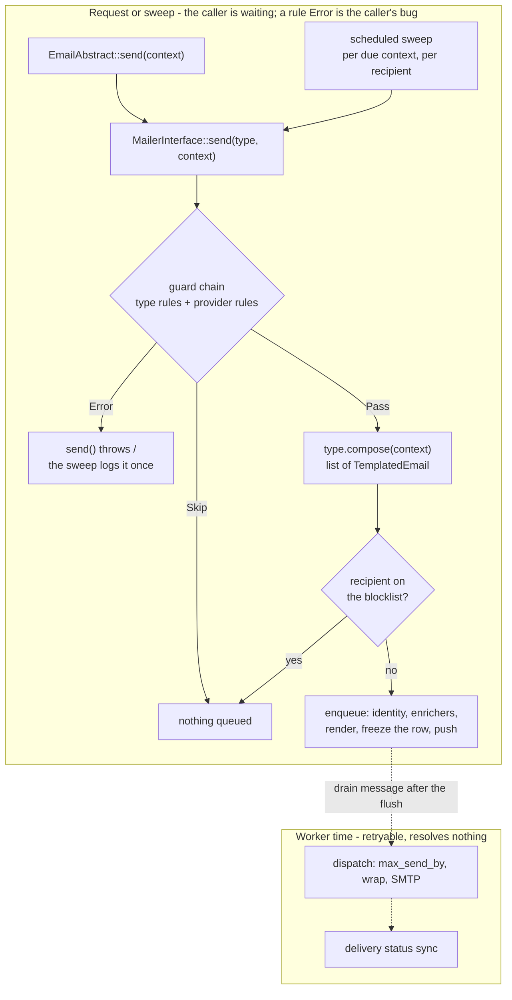

# Email

> The engine every outgoing mail runs through: the guard chain, the queue, templates, the layout, the blocklist, the
> send log, scheduled sweeps, dispatch and delivery status. It knows no email type: the application's types - and any
> a plugin adds - describe a message; the module decides whether it goes out, freezes how it looks, and sends it.
> Built and guarded as described in [modules/README.md](../README.md).

## One pipeline, whatever triggered the mail

A type only **composes**. Calling `send()` on it hands the type to `MailerInterface::send()`, and the scheduled sweep
calls the same method once per recipient, so a triggered mail and a scheduled mail take the same path and meet the
same checks.

The guard chain is the type's own `getGuardRules()` followed by every `GuardRuleProviderInterface`'s rules for that
identifier; the first result that is not a pass decides. `SendOutcome` reports the guard result and how many messages
were queued.

**The blocklist is checked on the composed recipient address**, so it covers every type, including ones whose
recipient is not a member, without a rule having to be declared. A row queued before an address was blocked is still
sent; dispatch does not re-check.

**The context array is opaque.** It carries whatever the type needs - entities included - from the caller back to the
same type's `compose()` and rules. The module passes it through and never reads it; the sweep only merges the
recipient in under the `user` key. The guard cannot see inside an array, so this rule is written here rather than
enforced.

## The module owns the engine, not the messages

What a message says and who may receive it is domain code, so it stays in the application: the email types and their
convenience base `App\Emails\EmailAbstract`, the guard rules in `App\Emails\Guard\Rule\`, the shipped template bodies
in `templates/email/defaults/` (served by `App\Emails\CoreTemplateProvider`), the request-derived sending identity
`App\Emails\RequestSendingIdentityProvider`, `AudienceFilterService`, which narrows installation-wide recipient lists
before a type is ever called, and `app:email:preview`, a thin command over `PreviewSweepInterface`.

## Enqueue decides everything, the send path resolves nothing

Enqueue resolves the sending identity, runs the context enrichers, renders subject and body, and freezes the result
onto the queue row: the rendered fragment, and the identity as a `_layout` snapshot. Dispatch, on a worker, reads
only the row, lookups keyed by stored values, the layout template and the translation catalogue - no request, no
membership query, no provider chain. `LayoutRendererTest` proves it by wrapping a frozen row with every live resolver
replaced by one that throws.

Two things stay unfrozen on purpose: the layout template and its footer strings are rendered at send time, so a
layout or wording change reaches mail already queued. A row that carries no `_layout` is sent as the bare body with a
logged warning rather than branded from live state.

`host`, `url` and `greeting` belong to enqueue: it takes them from the resolved identity and overwrites whatever a
type or an enricher set, so a mail's links land on the same place its logo and footer name.

### Who is sending

`EmailInterface::getOrigin()` names the entity a message is about. Each `SendingIdentityProviderInterface`, in
priority order, may turn it into a `SendingIdentity` - name, URL, logo URL, sign-off, footer links, optional
attribution, optional accent colour - and the first non-null answer wins. Without an accent the layout takes the
global theme colours. The application registers `RequestSendingIdentityProvider` at the
lowest priority, answering from the live request; if every provider defers, enqueue throws. A provider that answers
for types with no origin must do so from stored data or the request host, never from anything only a worker lacks.

The logo is a remote image URL, never a MIME part. The URL is frozen; the bytes behind it are not, so a changed logo
reaches mail already sent. A `null` logo URL means no header image.

## Templates are keyed by the type's identifier

`getIdentifier()` is the primary key of the whole system: the queue row stores it, the stored template is looked up
by it, and the admin pages list by it. Default subjects, bodies and variables come from `TemplateProviderInterface`
implementations, merged in priority order, so a provider registered after the application's can replace a shipped
template by reusing its identifier.

Substitution escapes every value except the variables a `TemplateDefinition` lists in `htmlVariables`, and keeps the
line breaks of an escaped value as ` `. The list is per template: reusing a variable name in another template does
not make it raw there. Subjects are never escaped.

A stored row must exist before an identifier can be queued. `app:email-templates:seed` creates the missing ones and,
with `--overwrite`, resets every translation to the shipped default - discarding admin edits; editing a default on
disk does not otherwise reach an existing install. `TemplatesInterface` adds a newly enabled language to every stored
template that lacks it, resets one template in every stored language - the call for a data hotfix after a default
changed its variables - and removes a stored template whose definition is gone.

## Scheduled mail is swept, not triggered

A `ScheduledEmailInterface` returns `DueContext`s, each with its potential recipients. The sweep (task
`scheduled-emails`) runs every recipient through the pipeline above and marks each context sent once, not once per
recipient. Its cadence keeps it to daytime hours, so types do not check the time.

`getMaxSendBy()` lets a type refuse to be sent late: a reminder or a cancellation notice is useless after the event
starts. It is frozen at enqueue, and a row past its cap is marked `Late` instead of sent. Token-carrying mail does not
set one - the token has its own expiry.

## A queued row wakes a worker; the queue drains on a time budget

The row is the record and the message is only a doorbell (see [modules/task/README.md](../task/README.md)). Enqueue
dispatches a `Drain` message right after its flush, and the sweep does the same after each of its flushes, so a
triggered mail leaves within about a second. The task `email-queue` runs the same drain as the backstop for a message
that never arrived, or for a row committed inside a caller's own transaction, which a drain can claim only after that
commit.

- **A drain runs on a time budget, not a count.** It claims `Pending` rows in chunks until a chunk comes back short or
  `EmailService::SEND_BUDGET_SECONDS` have passed; one that stopped on its budget with a full chunk dispatches another
  `Drain` and ends, so no worker is held for long. A budget sends as much as SMTP, an HTTP API or `null://` allow in
  the same wall time; a count would fit only the transport it was tuned for.
- **A chunk is claimed, not selected.** `EmailQueueRepository::claimPending()` stamps a token on rows in an UPDATE that
  repeats the claim condition, and the run sends only rows carrying its token. Two drains never send the same mail,
  and an empty one costs one UPDATE, so drains need no deduplication.
- **A crash loses at most the mail in flight.** Each outcome is flushed as soon as it is known, releasing its claim; a
  process that dies mid-send leaves one mail whose claim expires after `EmailService::CLAIM_LEASE_SECONDS`, and a
  later run sends it again. Chunks are detached as they finish, so memory stays flat however long the queue is.
- **The sweep never marks a context done with mails unwritten.** It flushes in chunks and always before marking a
  context sent.

## Push notifications ride the enqueue

Every `PushDispatcherInterface` is called for each queued message, after the row is persisted and before the flush.
A dispatcher must not throw and must not flush; one that throws anyway is logged and skipped. A type whose mail
follows a ping sent elsewhere returns `false` from `pushOnEnqueue()`, and the sender of that ping calls
`MailerInterface::dispatchPush()` directly. The preview sweep and the debugging page never push.

## Delivery status is the sending provider's answer

`DeliveryProviderInterface` is a provider chain: the first implementation whose `isAvailable()` is true answers. The
shipped providers - Mailpit for the dev stack, Sweego for a `sweego*` DSN - read the same `MAILER_DSN` that decides who
sends, so the sender and the reporter cannot disagree. With none available, the send log hides its sync button and
the task `email-delivery-sync` reports "provider unavailable" instead of failing.

## The contract

Everything outside the module talks to `Module\Email\Contract\`.

| Chain shape          | Seam                                        | Answers                                   |
|----------------------|---------------------------------------------|-------------------------------------------|
| tagged, one per type | `EmailInterface`, `ScheduledEmailInterface` | what a type composes, when it is due      |
| union                | `GuardRuleProviderInterface`                | extra rules for an identifier             |
| first non-null wins  | `SendingIdentityProviderInterface`          | who a message is sent as                  |
| all run, in order    | `ContextEnricherInterface`                  | extra template variables at enqueue       |
| all run              | `PushDispatcherInterface`                   | a push for each queued message            |
| merged by priority   | `TemplateProviderInterface`                 | default subject, body and variables       |
| first available wins | `DeliveryProviderInterface`                 | delivery status from the sending provider |

The facades are `MailerInterface` (send, evaluate the chain, push without a mail), `TemplatesInterface`,
`BlocklistInterface`, `SendlogInterface` and `PreviewSweepInterface` (one mock mail per type and language, for dev
and test). Everything else in the namespace is a readonly value object or an enum. `TemplatedEmail` crosses the
boundary as Symfony substrate: `compose()` returns a list of them.

## Surfaces

The admin area lives at `/admin/email/*` behind `ROLE_ADMIN`, with routes named `app_admin_email_*` and templates
under `@Email/`:

- **Templates** - list, edit per language, preview with the type's mock data, reset to the default.
- **Planned** - scheduled mail due soon, and every rule's verdict for one of them.
- **Debugging** - queue any type with mock context to a chosen address. It goes through the queue and the blocklist,
  so a worker sends it like any other.
- **Send log** - queued and sent mail, the frozen layout rendered in a sandboxed frame, delivery status sync, and
  "Clear cap & retry" for a row that went late.
- **Blocklist** - add and remove addresses. Adding one that is already blocked keeps its first reason.

It also contributes a bell entry for mail pending too long, the `email_queue` metrics gauge, and the tasks
`email-queue`, `scheduled-emails` and `email-delivery-sync`. The outbound permit list in `mago.toml` names every core
class the module reaches for, each with its reason.

## Becoming a consumer: writing a type

1. Extend `App\Emails\EmailAbstract` (or implement `EmailInterface` yourself) and pick an identifier.
2. `compose()` returns the messages - one, several, or none - with sender, recipient, locale and context.
3. `getGuardRules()` declares every condition under which the mail must not go out; rules run before `compose()`.
4. Override `getMaxSendBy()` if the mail is useless after a deadline, `getOrigin()` if it is about an entity that
   decides who sends it, `getAttachments()` for files read again at dispatch.
5. `getDisplayMockData()` feeds the admin preview, the debugging page and the preview sweep. Mirror what production
   produces, not what it should.
6. Ship a default template through a `TemplateProviderInterface` and run `app:email-templates:seed`.

The suggestion module's `Internal\Emails\` - two types and their template provider - is the smallest complete
example; `modules/email/tests/Stub/` holds a stand-in for every seam.
