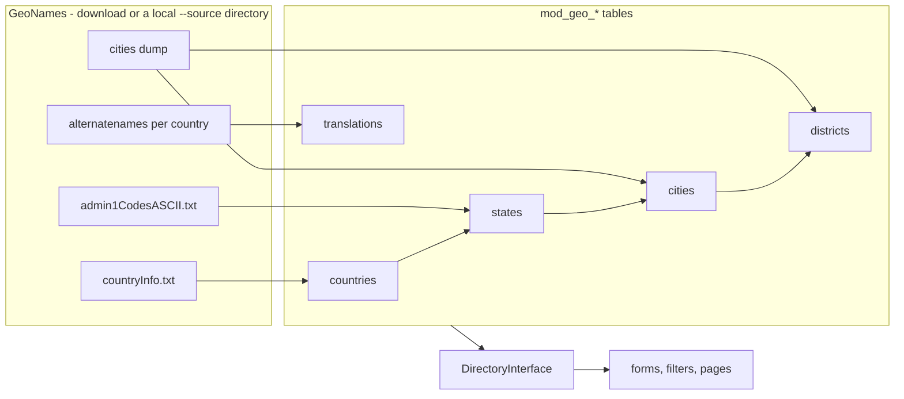

# Geo

> A local copy of the GeoNames gazetteer - countries, states, cities and districts with their names in the
> application's languages - and one read contract over it. The module imports and answers; what a city is attached
> to, and what a page does with it, belongs to its consumers. Built and guarded as described in
> [modules/README.md](../README.md).

## The import adds and updates, it never deletes

`Internal\Import\Loader` runs one dataset at a time (`Import\Dataset`): countries, states, cities, districts, then
translations. Every row is keyed on its GeoNames id, so a second run updates in place and adds no duplicate, and a
row GeoNames drops stays. Consumers keep plain city ids, so a deleted row would leave them pointing at nothing.

- **Scope by country.** Without a country a dataset covers every country it has data for; with one it covers that
  country only, so an installation grows its directory a country at a time. Translations come from one
  alternate-name file per country, streamed line by line, never the single worldwide file.
- **What counts as a city.** A populated place that is not a section, historic, abandoned or destroyed place, above
  the minimum population that picks the dump; a capital or a state seat is kept whatever its population. A section
  (`PPLX`) becomes a district of the nearest more populous city of its state within `Loader::DISTRICT_RADIUS_KM`.
- **Which name wins.** For one place and language a name GeoNames marks both preferred and short wins, then a
  preferred name, then a plain alternate; a short name alone is a last resort, and historic or colloquial names are
  never taken. Languages are `Loader::LANGUAGES`.
- **Countries are derived last.** `countryInfo.txt` has no coordinates, so after the cities each country takes its
  capital's position and its cities' extent as its bounding box.
- **Nothing is cached between runs.** Each download lands in the system temp directory and is deleted when its
  dataset is done; the release image's root filesystem is read-only.

The same import runs from three places, which all read their options through `ImportAction::options()`: the console
command `app:geo:import <dataset|all>` (`--country`, `--min-population`, `--source`, `--base-url`), the
`geo-import` action on the Maintenance page (see [modules/task/README.md](../task/README.md)), and the `geo-refresh`
task. The task refreshes countries and states only, and does nothing while no country is imported, so an installation
that never uses the module never reaches the network.

## A city has two slugs

`slug` is the city's address: unique within its country, with a numeric suffix when two cities share a name, and
the most populous city of that name gets the plain one. `nameSlug` is what the city is called - the slugged name
without a suffix, on the city and on every translation - and is what name lookups match. A second Berlin in one
country therefore has the address `berlin-2` but still answers to `berlin`.

## Every name arrives resolved

A view carries the name in the requested language, else English, else the ASCII name; no caller sees the chain.
`findCitiesNamed()` matches a name against the `nameSlug` of every city and its translations. `findPlaceNamed()`
matches a single label against cities, countries and their translations, and retries with German umlauts spelled out
(`ae`, `oe`, `ue`) folded back, so `muenchen` finds Munich.
Search orders by population, so the well-known city of a shared name comes first.

## Attribution is an obligation

GeoNames data is CC BY 4.0. Every public page that renders names or positions from the directory includes
`@Geo/attribution.html.twig`.

## The contract

Everything outside the module talks to `Module\Geo\Contract\`, and the module offers no chain: `DirectoryInterface`
looks cities up by id, by a page of ids, by country and slug, by GeoNames id and by name, searches them for the
autocomplete, lists countries and counts cities per country. `CityView` and `CountryView` are the readonly views it
returns. `hasCities()` says whether anything is imported and
is memoised per service instance. The autocomplete endpoint `app_geo_cities` reads through the same directory,
requires a login, and ignores a query shorter than `CityController::MIN_QUERY_LENGTH`.

## Surfaces

- **Console** - `app:geo:import` with one dataset or `all`.
- **Maintenance page** - the `geo-import` action: its facts count every dataset and name the countries that have
  cities and translations, and its remembered
  values (download address, minimum population) are what the `geo-refresh` task uses.
- **Endpoint** - `GET /{_locale}/geo/cities?country=&q=` for the city field's autocomplete.
- **Template** - `@Geo/attribution.html.twig`.

## Moving data between instances

The directory itself does not travel: every installation imports it from GeoNames. Rows that point at a city travel
by its GeoNames id, the one key that is the same everywhere, with the country and name beside it for a human reader;
the importing side resolves it with `findCityByGeonameId()` and leaves the field empty, with a note in its summary,
when its own directory lacks the city.

## Becoming a consumer

1. **Store a plain integer `cityId`**, no foreign key into `mod_geo_*`. The import never deletes, so the id stays
   valid; an integrity check is the place to report one that no longer resolves.
2. **Read only through `DirectoryInterface`**, never the module's entities or tables, and resolve a page of ids with
   one `findCities()` call.
3. **Gate the feature on `hasCities()`.** While nothing is imported, a city field is left out and any requirement on
   it lapses - an installation without the directory loses nothing.
4. **Include the attribution** on every public page that shows geo data.
5. In an export, write the GeoNames id (`CityView::$geonameId`), not the local id.

## Traps

- The local city id differs between installations; only the GeoNames id is portable.
- `hasCities()` is memoised: a test that empties the directory must do so before the first lookup in that container.
- The sample under `modules/geo/tests/Sample/` is in GeoNames dump format and is what every development and test
  database imports with `--source`; a fixture that names a city needs that import to have run first.

## Related

- [modules/task/README.md](../task/README.md) - the action and the task the import runs as
- [modules/README.md](../README.md) - how a module is built, wired and guarded
