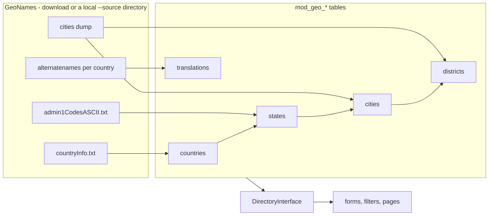
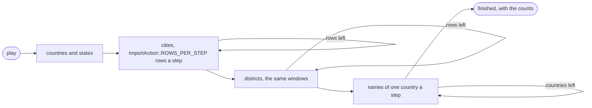

# Geo

> A local copy of the GeoNames gazetteer - countries, states, cities and districts with their names in the
> application's languages - and one read contract over it. The module imports and answers; what a city is attached
> to, and what a page does with it, belongs to its consumers. Built and guarded as described in
> [modules/README.md](../README.md).

## The import adds and updates, it never deletes

The import runs one dataset at a time: countries, states, cities, districts, then translations. Every row is keyed on
its GeoNames id, so a second run updates in place and adds no duplicate, and a row GeoNames drops stays. Consumers keep
plain city ids, so a deleted row would leave them pointing at nothing.

- **Worldwide.** The import covers every country GeoNames has; translations come from one alternate-name file per
  country, streamed line by line, never the single worldwide file.
- **What counts as a city.** A living populated place above the minimum population that picks the dump; a capital or
  a state seat is kept whatever its population. A section of a city becomes a district of the nearest more populous
  city of its state, within `Loader::DISTRICT_RADIUS_KM`.
- **Which name wins.** GeoNames' preferred and short flags rank the names of one place and language; historic or
  colloquial names are never taken. The languages are the enabled ones, so enabling a language and pressing play
  again fills its names.
- **Nothing is cached between runs.** Each download lands in the system temp directory and is deleted when its
  dataset is done; the release image's root filesystem is read-only.

## The import runs in steps, and only when someone starts it

`ImportAction` has no parameters: the admin presses play on the Maintenance page and the action walks the steps above,
each one its own worker message, by returning the next cursor to the task module (see
[modules/task/README.md](../task/README.md)). A step is small enough that no message outgrows a worker's memory,
even with the development query log. The scope is fixed: GeoNames' download address and
`Options::DEFAULT_MIN_POPULATION`.

- **Windows keep the slug rules.** Every city window reads the whole dump to find the most populous city of each name
  and takes the slugs already used from the database, so a window writes the same rows the whole file would.
- **Every press fetches every country's names**, so new cities get theirs and renamed places follow GeoNames.
- **Nothing schedules it.** An installation that never presses play never reaches the network.

The console command `app:geo:import` walks the same steps in one process, or runs one dataset; its options exist for
development and the tests, which import the sample through `--source`.

## A city has two slugs

`slug` is the city's address: unique within its country, with a numeric suffix when two cities share a name, and
the most populous city of that name gets the plain one. `nameSlug` is what the city is called - the slugged name
without a suffix, on the city and on every translation - and is what name lookups match. A second Berlin in one
country therefore has the address `berlin-2` but still answers to `berlin`.

## Every name arrives resolved

A view carries the name in the requested language, else English, else the ASCII name; no caller sees the chain.
Name lookups match the `nameSlug` of every city and its translations, and fold spelled-out German umlauts back, so
`muenchen` finds Munich. Search orders by population, so the well-known city of a shared name comes first.

## Attribution is an obligation

GeoNames data is CC BY 4.0. Every public page that renders names or positions from the directory includes
`@Geo/attribution.html.twig`.

## The contract

Everything outside the module talks to `Module\Geo\Contract\`, and the module offers no chain: `DirectoryInterface`
looks cities up and searches them, lists countries and counts cities per country, returning readonly views.
`hasCities()` says whether anything is imported. The city field's autocomplete endpoint reads through the same
directory, requires a login, and ignores a query shorter than `CityController::MIN_QUERY_LENGTH`. The Maintenance
page carries the `geo-import` action, with the step's progress and every dataset's count.

## Moving data between instances

The directory itself does not travel: every installation imports it from GeoNames. Rows that point at a city travel
by its GeoNames id, the one key that is the same everywhere, with the country and name beside it for a human reader;
the importing side resolves it with `findCityByGeonameId()` and leaves the field empty, with a note in its summary,
when its own directory lacks the city.

## Becoming a consumer

1. **Store a plain integer `cityId`**, no foreign key into `mod_geo_*`. The import never deletes, so the id stays
   valid; an integrity check is the place to report one that no longer resolves.
2. **Read only through `DirectoryInterface`**, never the module's entities or tables, and resolve a page of ids with
   one `findCities()` call.
3. **Gate the feature on `hasCities()`.** While nothing is imported, a city field is left out and any requirement on
   it lapses - an installation without the directory loses nothing.
4. **Include the attribution** on every public page that shows geo data.
5. In an export, write the GeoNames id (`CityView::$geonameId`), not the local id.

## Traps

- The local city id differs between installations; only the GeoNames id is portable.
- `hasCities()` is memoised: a test that empties the directory must do so before the first lookup in that container.
- The sample under `modules/geo/tests/Sample/` is in GeoNames dump format and is what the test databases and the
  core development modes import with `--source`; a fixture that names a city needs that import to have run first.

## Related

- [modules/task/README.md](../task/README.md) - the Maintenance action and the cursor the import's steps run on
- [modules/README.md](../README.md) - how a module is built, wired and guarded
