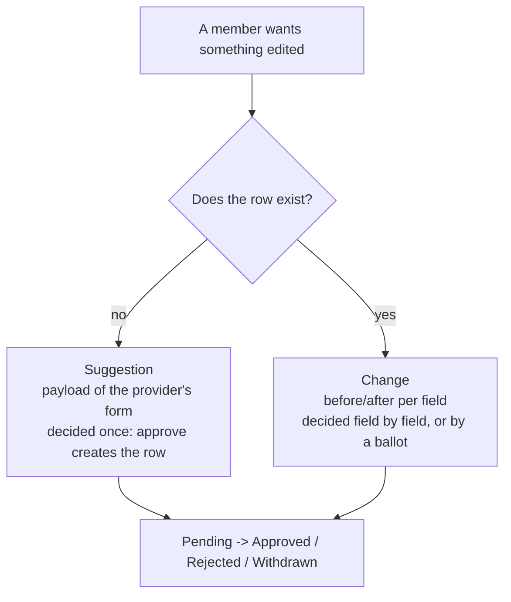

# Proposal

> Members propose edits a reviewer decides on, in two shapes: a **suggestion** proposes a whole new row, a
> **change** proposes new values for a row that exists. Both share one lifecycle, one status vocabulary, the review
> hub and the activity log; each has its own provider seam, table and review page. Inert until a provider registers a
> type. Built and guarded as described in [modules/README.md](../README.md).

## Two tools, one lifecycle

A suggestion and a change share everything around their payload: the four `Status` values, a proposer and a reviewer,
resolution stamped with who and when, withdrawal by the proposer alone, a provider registry gated on the global
plugin list, an entry in the review hub, and activity entries when a proposal is made and when it is resolved. They
share nothing in the payload itself, so the module holds two services side by side instead of one engine with a
switch.

The split follows what is proposed:

| Tool                       | Row exists when proposed | Reviewer resolves                       | Table                     |
|----------------------------|--------------------------|-----------------------------------------|---------------------------|
| suggestion (suggestion.md) | no                       | the whole thing, once                   | `mod_proposal_suggestion` |
| change (change.md)         | yes                      | each field, or hands one to the members | `mod_proposal_change`     |

A change applies to a target id, and a suggested row has none until approval creates it. Creation is atomic for the
same reason: half a venue is not a venue, so a suggestion has no field-by-field resolution and no ballot.

## Each tool has its own seam

A single provider interface would be the union of both, and every implementer would stub half of it. A type is
made suggestible and changeable independently; core's venue implements both, through two classes.

| Chain shape                   | Seam                                 | Answers                                            |
|-------------------------------|--------------------------------------|----------------------------------------------------|
| one per target type, union    | `Suggestion\TargetProviderInterface` | how a type is proposed into existence and created  |
| first registered, at most one | `Suggestion\ScopeProviderInterface`  | where a suggestion was made, and running there     |
| one per target type, union    | `Change\TargetProviderInterface`     | how a field of a row is labelled, checked, written |
| family fallback               | `Change\TargetFamilyInterface`       | one provider serving every type of a family        |
| optional, on a change target  | `Change\ScopedTargetInterface`       | a wider apply that also writes further rows        |

Each tool has its own facade, `Suggestion\SuggestionInterface` and `Change\ChangeInterface`, its own `View` and its
own `Portable*` value object for fixtures and archives. Both speak in user ids; neither returns an entity.

## One public template

`@Proposal/change/_card.html.twig` renders one pending change as a field table with its actions, and is the only
template the application includes from outside: the `/contribute` correction forms show the member's own pending
changes with it. It reads a `Change\View` plus the rows the caller hands in, so a caller never needs the entity.

## Seams

- **A type becomes suggestible** with `Suggestion\TargetProviderInterface`; reference
  `App\Item\Location\SuggestionTarget`. Details in suggestion.md.
- **A type becomes changeable** with `Change\TargetProviderInterface`; reference
  `plugins/glossary/src/Review/GlossaryChangeTarget.php`. Details in change.md.
- **A place travels with a suggestion** through `Suggestion\ScopeProviderInterface`.

The outbound permit list in `mago.toml` names every core class the module reaches for, each with its reason.

## Traps

- **The previous releases still read the old table names.** `mod_suggestion` and `change_proposal` exist as
  updatable views over the module's tables until the cleanup migration drops them; a fresh install creates them too.
  A tool that drops tables without views - such as a partial reset - leaves them behind and breaks the next
  migration run, so reset by dropping the database.
- **The module registers two migration namespaces.** `ModuleSuggestionMigrations`
  (`modules/proposal/migrations/suggestion/`) keeps the history the suggestion tool shipped with, because Doctrine
  records executed migrations by class name; `ModuleProposalMigrations` (`modules/proposal/migrations/change/`) holds
  the change table's. Doctrine orders by namespace, so a new migration for a suggestion table goes into the first and
  one for a change table into the second.

## Related

- suggestion.md - proposing a row that does not exist yet
- change.md - proposing new values for a row that exists, and handing a field to the members
- `modules/ballot/README.md` - the module a contested field is decided on
