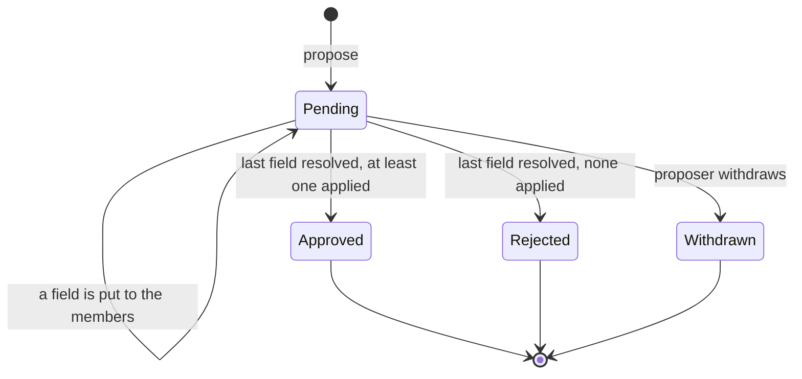

# Changes

> A member proposes new values for a row that exists; a reviewer applies or denies them field by field, or hands a
> contested field to the members as a ballot. One `mod_proposal_change` table holds a polymorphic target reference
> and a before/after field map; a provider registers a type as changeable, and the module supplies the per-field diff
> page and the review hub entry. The module never interprets a field name or value. The sibling tool for rows that do
> not exist yet is [suggestion.md](suggestion.md); what both share is in [README.md](README.md).

## One row per submit, resolved field by field

A member without direct edit rights submits an edit form; instead of writing the entity, the consumer builds a list
of `Change\FieldChange` and calls `Change\ChangeInterface::propose()`, which drops unchanged fields and returns null
for an empty change set, otherwise the new proposal's id. A reviewer resolves the proposal per field on the diff
page, or wholesale from the review hub. Per-field resolutions accumulate inside the row and the proposal finalizes
when the last field resolves. Resolved rows are kept for audit; nothing cleans them up.

The target is a type and an id with no foreign key, so a plugin can make its own rows changeable. Values are stored
as `string|null`; a structured target string-encodes.

## The provider owns every interpretation

Labels (`getFieldLabel`, `formatValue` - resolving a category id to its label), permissions (`canPropose`,
`canReview`, given a user id), validation and the write itself (`apply`) live in the provider. `validate()` runs again
at apply time as a staleness guard and returns a pre-translated error. Applying a field routes the value back through
the provider, so the module never writes a consumer's table.

A switched-off plugin's providers drop out of the registry through the application's `ActivePluginsPass`, which reads
the global plugin list, not the request-context list: a proposal must stay resolvable wherever a reviewer works from.
Per-context enforcement lives in `canPropose()` / `canReview()` plus target visibility - a provider resolving its
target through a context-filtered service returns a null label for a target the current context cannot see, and the
UI 404s on a null label.

## A reviewer works on the diff page or in the hub

- **The diff page** (`app_review_proposals`) shows per-field before and after with apply and deny for reviewers and
  withdraw for the proposer. It is visible to reviewers and to the proposer of a pending proposal, and 404s when the
  provider is inactive or the target label is null.
- **The hub** (identifier `change_proposals`) lists one entry per pending reviewable proposal with its unresolved
  fields as before/after rows. Approve applies every unresolved field, validating all of them first and aborting
  before any write on failure; deny rejects the whole proposal.

Both surfaces, and the pending lists a consumer shows beside its own form, render a field through the application's
`_components/value_diff.html.twig`: old and new value side by side, the changed words marked by `text_diff()`, which
leaves both sides unmarked when the change is too large to read as a diff (`TextDiffExtension` holds the limits).

Activity: `core.change_proposal_created` for the proposer, `core.change_proposal_applied` /
`core.change_proposal_rejected` for the reviewer on finalization; withdrawing logs nothing.

## One provider can serve a family of target types

A provider normally registers under the single type `getTargetType()` returns. When one provider has to serve a
whole family it also implements `Change\TargetFamilyInterface`: the registry first looks for an exact match, then asks
each family provider whether it handles the type and, if so, for an instance bound to it. The fallback is not
plugin-gated, so a family provider owns its own activity check. The application's tag vocabulary is the reference: one
provider serves `item_tag_<typeKey>` for every taggable type.

## A contested field can be handed to the members

A reviewer looking at an unresolved field has a third move besides apply and deny: **put it to the members**. That
opens a `modules/ballot/` ballot with purpose `Change\ChangeInterface::BALLOT_PURPOSE` and the change target as its
subject. The candidates are the distinct values proposed for that field across the target's pending proposals, plus
one for leaving the value alone; two proposals suggesting the same string collapse into one candidate, so the count
measures values, not proposers.

**Whoever may propose a change to a target may vote on which proposed change wins.** The field ballot's electorate
asks the provider's `canPropose()`, so the vote is scoped by whatever rule the provider applies.

The steward sets the deadline and tally mode in the shared ballot-terms overlay; one overlay serves every contested
field on the page, which is why the route takes the field in the body. A field ballot defaults to
`FieldBallotService::DEFAULT_MODE` rather than the overlay's own default, because only one value can end up written.

## The members decide, a person commits the write

Settlement is `Confirmed`, never `Automatic`. A provider's `canReview()` may answer from the current request's user,
so a write attempted from the settling task (`ballot.settle-due`) can have no token to be granted against and be
refused, leaving the ballot settled and the field unwritten. The task therefore only tallies; the reviewer presses
confirm and the field is applied inside their request exactly as a manual approval is, recorded as theirs. Confirming
tallies first when the deadline has passed but the task has not run yet.

Confirming applies the winning value and **denies the same field on every other pending proposal for that target**,
which would otherwise sit pending against a value that has since changed. A tie is left alone: confirm refuses, and
the row keeps its apply and deny buttons.

## A provider may offer a wider apply

`Change\ScopedTargetInterface` lets a provider declare one extra scope for a target - a key and a pre-translated label
stating how many rows it touches - and write the value onto those rows. The review card renders it as a second apply
button; without the interface the card is unchanged. The scope travels as a `scope` query parameter on the apply and
ballot-confirm routes, and the module checks it against what the provider declares **before** anything is written,
so a stale or forged key changes nothing. A field ballot picks the scope at confirm, not at open: settling applies
unscoped, and confirming spreads the applied value. The hub's whole-proposal approve stays unscoped.

## Moving data between instances

`exportPending()` hands out the pending proposals of the given target types as `Change\View`s, and `restore()` writes a
`Change\PortableChange` back as pending, skipping permission checks, validation and activity, and returns its new
id. Archive sections and fixtures are their callers; an importer remaps proposal references by those ids.

## Becoming a consumer

1. Implement `Change\TargetProviderInterface`. It is tagged automatically.
2. Build the field map on your edit form's submit and call `propose()`; **let the module log** - logging again
   doubles the activity entry.
3. **Remove your proposals when your target is deleted.** Nothing cascades: call `removeForTarget()` in the delete
   path. A family provider whose rows are deleted elsewhere relies on `validate()` and a null label instead.
4. Show a pending count on your own surfaces with the `pending_change_proposals(targetType, targetId)` Twig function
   rather than injecting the facade into a cell provider.

The glossary plugin's `GlossaryChangeTarget` is the reference, with the propose side in its contribution section's
`changesFrom()`, and `modules/proposal/tests/Stub/Change/` the smallest stand-in.
