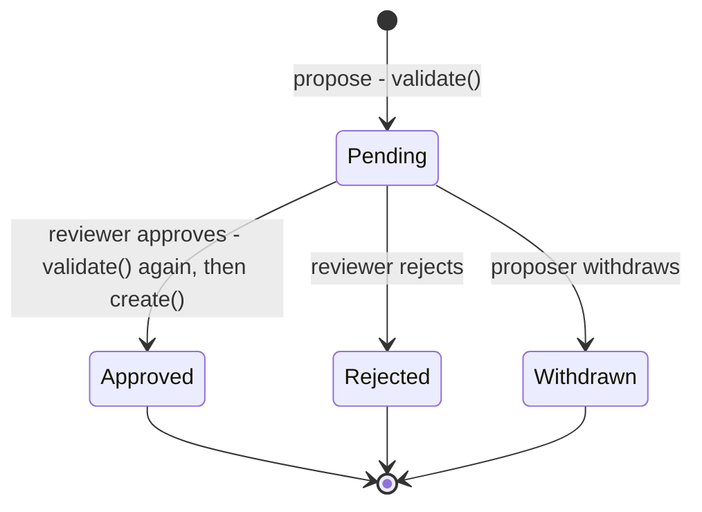

# Suggestion

> A member proposes a whole new row, a reviewer edits it, and approving it creates the row. One `mod_suggestion`
> table holds each proposal as a payload against a target *type*; a tagged provider makes a type suggestible, and
> the module supplies the edit-then-approve page and the review hub entry. Inert until a provider registers a type.
> Built and guarded as described in [modules/README.md](../README.md).

## A suggestion is resolved in one act

There is no partial state: one row, resolved once. `createdId` records which row approval produced, so the audit
trail survives without a foreign key to it. Resolved rows are kept.

`validate()` runs twice, and the second run is the staleness and uniqueness guard: a duplicate that appeared while
the suggestion sat in the queue is caught *before* the first write, so a collision never leaves a half-created row.

## The tool owns creation, its sibling owns editing

| Tool                             | Row exists when proposed | Reviewer resolves      | Table             |
|----------------------------------|--------------------------|------------------------|-------------------|
| change proposals (core `Review`) | yes                      | each field, one by one | `change_proposal` |
| this module                      | no                       | the whole thing, once  | `mod_suggestion`  |

A change proposal applies to a target id, and a suggested row has none until approval creates it. The resolution
granularity differs for the same reason: a venue's fields are accepted or rejected as one unit, because half a venue
is not a venue.

## The provider hands back an entity and a form, not a schema

`TargetProviderInterface` returns a real unsaved entity plus the class of a Symfony form type. The member's submit
form and the reviewer's edit form are therefore the same form, and the stored payload is that form's round-tripped
data. The draft crosses the boundary as `object`: it is the consumer's own entity, which the module stores only as a
payload and hands back to the same provider.

The module never interprets a payload. Display, permission (given a user id), validation and the write itself all
live in the provider.

**A boolean approval flag on the target table is what this tool replaces.** It costs three times: the pending row is
invisible to the review hub unless the plugin also writes a review provider, every read path grows a branch to hide
rows the table should never have held, and refusing one deletes a real row instead of keeping a rejected payload. A
proposed row that is not in the target table yet needs none of that.

## A suggestion is reviewed where it was made

A provider answers `canReview()` from the reviewer's current context without being told which suggestion is asked
about. On its own that would let a reviewer from one place approve a suggestion made in another, with the created row
landing in the reviewer's place.

`ScopeProviderInterface` closes that gap mechanically. `capture()` returns an opaque key for the place the current
request runs in, stored on the suggestion at propose time. Every later check and write for that suggestion runs
inside `runIn(scope, ...)`: the review listing, the detail page and its form, inline approve and deny, and the second
`validate()` plus `create()`. A reviewer sees only the suggestions their role covers in the place each was made, and
the row is created there. With no implementation, or a null key, everything runs in the reviewer's own context.

## The proposer hears the outcome

Approving sends `suggestion_approved` and rejecting sends `suggestion_rejected` to the proposer, for every target
type; withdrawing sends nothing. Both are application email types in `Internal\Emails\`, with default bodies in
`modules/suggestion/templates/email/defaults/`, and they are sent inside the suggestion's scope, so the mail carries
the branding of the place it was made in.

## Providers of inactive plugins drop out; the empty key means core

`Internal\Registry` drops the providers of plugins that are not globally active, so a suggestion stays resolvable on
every host a reviewer works from. A provider whose `getPluginKey()` is `''` is a core provider and always active;
without that exemption it would be silently dropped, because the empty string is never in the active-plugin list.

## The contract

| Chain shape                   | Seam                      | Answers                                        |
|-------------------------------|---------------------------|------------------------------------------------|
| one per target type, union    | `TargetProviderInterface` | how a type is proposed, shown and created      |
| first registered, at most one | `ScopeProviderInterface`  | where a suggestion was made, and running there |

`SuggestionInterface` is the facade: the provider for a type, propose, a member's pending suggestions, find, and
restore. `View` is a suggestion as callers see it, `Status` the four states with their label keys, and
`PortableSuggestion` a pending suggestion with its scope, to store as given. `propose()` returns the provider's
refusal as a translated string rather than throwing, because a contract class is final and readonly and an exception
cannot be.

## Surfaces

- **Propose** - the application's `/contribute` hub owns the entry point: a section whose type has a provider gets
  `app_contribution_suggest`, shown when the provider's `canPropose()` says yes, and lists the member's own pending
  suggestions. A new provider needs no template change.
- **Review hub** - identifier `suggestions`: one item per pending suggestion the viewer may review. Inline approve
  takes the suggestion exactly as submitted; inline deny rejects it.
- **Detail page** - `app_review_suggestion`. The reviewer gets the provider's form pre-filled from the payload and one
  **Save & Approve** that applies the edits and the decision together, or **Reject**; the proposer of a pending
  suggestion gets a read-only summary and **Withdraw**. Anyone else gets a 404, as does everyone once the provider is
  inactive. Reject and withdraw are `data-post` anchors guarded by a per-suggestion CSRF token.
- **Activity** - the three messages in `Internal\Activity\` (created by the proposer, approved and rejected by the
  reviewer), carrying the target type, the created id and the provider's description. Withdrawing logs nothing.

The outbound permit list in `mago.toml` names every core class the module reaches for, each with its reason.

## Moving data between instances

`restore()` writes a `PortableSuggestion` back as given, skipping permission checks, validation and activity, with
its scope, so seeded suggestions can be scoped too. Fixtures are its caller.

## Becoming a consumer

1. Implement `TargetProviderInterface`. It is tagged automatically.
2. **Guard uniqueness in `validate()`, not in `create()`**: it is the only hook that runs before the first write.
3. **Dispatch your entity actions inside `create()`.** A row created without its action is invisible to everything
   that listens for it.
4. Owe no delete path: a suggestion has no target row, so nothing can orphan it.

Core's venue provider, `App\Item\Location\SuggestionTarget`, is the reference: it reuses the admin venue form
verbatim, so a suggested venue is validated by exactly the constraints an organizer-created one is, and dispatches
`EntityAction::CreateLocation` from `create()`. The glossary plugin's `GlossaryTarget` is the reference for a plugin
provider, and `modules/suggestion/tests/Stub/` the smallest stand-in.
