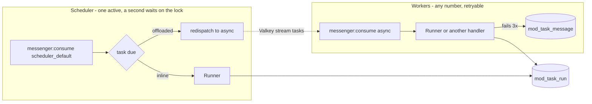

# Task module

Everything that runs outside a request: scheduled tasks, the message workers that pick up work a request hands
off, the run log and the heartbeat that tells whether the workers are alive.

## Two kinds of process run beside the web server

- **The scheduler** consumes the `scheduler_default` transport. Its schedule is locked through the Valkey lock store
  and stateful in `cache.app`, so a second scheduler stands by without doubling a run, and a restart neither skips
  nor repeats one.
- **The workers** consume `async`, a Valkey stream on the database `REDIS_URL` names. Each consumer is named after its
  host, so every pod or container claims its own messages. A message whose consumer died is taken over after five
  minutes.
- **A failed message** is retried three times with backoff, then lands in the Doctrine failure transport
  (`mod_task_message`), where it stays until someone retries or deletes it.

## A task declares its own cadence

A class implementing `Contract\TaskInterface` is a task: a stable identifier, a `Cadence` and a `run()` that returns
a `Result`. It needs no wiring. `Registry` collects every implementation, and `ScheduleProvider` turns each one into a
recurring message.

- `Cadence::$cron` is a cron expression in the server's timezone. A time window such as "only between 07:00 and
  22:00" belongs in the expression, not in an `if` inside the task.
- `Cadence::$jitterSeconds` spreads daily tasks so they do not all start at the same second. `CadenceTrigger` derives
  the delay from the identifier and the slot, so a scheduler that restarts between the slot and the delayed time still
  runs it, and the Tasks page shows the real next run.
- `Cadence::$offloaded` sends the run to a worker instead of running it in the scheduler process. Use it for anything
  that takes more than a few seconds, so the scheduler stays on time.

`RunRetention` is the reference task. It is also what keeps `mod_task_run` at 30 days.

## The row is the record, the message is a doorbell

Work a request hands off is written to its own table first: a mail queue row, a push queue row, an invoice. The
message dispatched after the flush only says "there is work", and its handler claims rows with a lease. A lost
message therefore loses nothing, and every doorbell has a slow task beside it that drains whatever is left, such as
`email-queue` every 5 minutes. A message carries an identifier at most, never the data it stands for.

`Contract\TriggerInterface::runSoon()` is the doorbell for a task: it sends one run of that task to a worker now,
for example `recurring-events` after an event series is edited, so nobody waits for the next scheduled run.

## How a plugin or a module adds work

- **Periodic work:** implement `Contract\TaskInterface`. While its plugin is switched off, the task drops out of the
  schedule and the Tasks page, like every other member of a core chain.
- **Work handed off by a request:** a message class, routed to `async`, and a handler marked `#[AsMessageHandler]`.
  Follow the doorbell rule and add a backstop task.
- **State between messages:** a worker handles many messages in one process, and Messenger resets only services that
  implement `ResetInterface`. A service that memoizes rows, entities, the current user or anything else that can
  differ between two messages implements it and clears that state in `reset()`. The entity manager is cleared after
  every message, so a kept entity would be detached anyway.
- **Switching a plugin on or off** asks every worker and scheduler to restart (Messenger's restart signal), so the
  schedule and the chains are rebuilt within seconds.

## The Tasks page reads the run log, the queue and the heartbeat

Admin, Logs, Tasks (`/admin/logs/tasks`) has three tabs: Schedules (every task, its cadence, next and last run, and
"run now"), Runs (the run log, filtered by task and status) and Queue (pending messages, the live workers and
schedulers, and failed messages to retry on their original transport or delete). `Contract\RunLogInterface` and
`Contract\HealthInterface` expose the run log and the worker health to other consumers, such as an API or a
status page.

## Every run is recorded, whichever process ran it

`Runner` executes a task, times it, catches anything it throws (logged, recorded as `exception`) and writes one
`mod_task_run` row with the host. The scheduler, the workers and `app:task:run` all go through it, so the run log is
the same whatever started the run.

## The heartbeat lives in Valkey

Every worker and scheduler process writes `task:heartbeat:<host>:<pid>` with a 90-second expiry while it runs, and
deletes it when it stops. A missing key means the process is gone. `Heartbeat::alive()` lists what is running.

## Commands

| Command                     | Does                                                                |
|-----------------------------|---------------------------------------------------------------------|
| `app:task:list`             | every task with its cadence, next run and last result               |
| `app:task:run <identifier>` | runs one task now, records it, exits non-zero on a failure          |
| `messenger:stop-workers`    | every worker exits after its current message (`just workerRestart`) |
