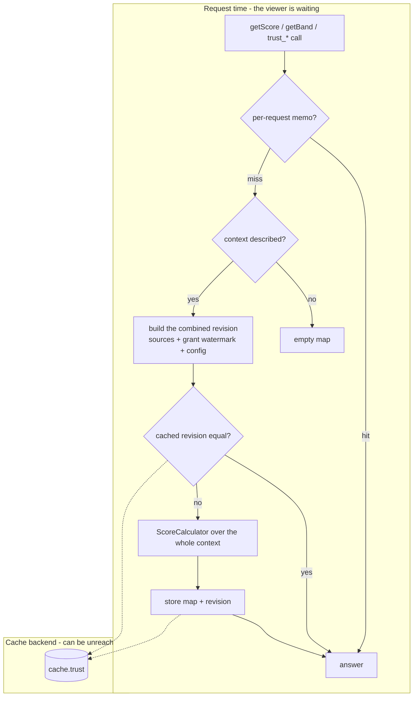

# Trust

> A context-scoped reputation engine. It answers one question - *how much does this community trust this member, in
> this context?* - with a number nobody ever stored. Inert until a consumer describes a context: on its own it has
> no contexts, no surfaces and no effect. Built and guarded as described in [modules/README.md](../README.md).

## Derived, never stored

The only persisted facts are member-to-member vouches (`mod_trust_grant`) and per-context configuration
(`mod_trust_context_config`). Scores are computed on read, every time, from three sources:

| Source        | Comes from                                           | Contributed via         |
|---------------|------------------------------------------------------|-------------------------|
| Root points   | authority - who runs this community                  | `RootProviderInterface` |
| Action points | the consumer's own immutable record of what happened | `ActionSourceInterface` |
| Vouches       | members, through the module's own surfaces           | stored here             |

Only the third is the module's own. The first two are entirely the consumer's vocabulary - Trust has no idea what the
actions it scores are.

This is the whole design. An administrator who raises the points for an action sees the *entire graph* move on the
next page load, including members several vouches downstream of anyone who ever performed it. That is only possible
because no score was ever written down, so there is no score history and no audit trail; a "why is my score X"
breakdown is computed on demand (`getExplanation()`), never recorded.

A vouch is editable, an action is not. Vouches live in a mutable table with an `updatedAt`; actions come from the
consumer's append-only record. That is the line between *what I currently believe* and *what happened*.

## The cached map carries its own staleness check



One entry per context in the `cache.trust` pool, with no TTL, holding the score map plus the **combined revision**
it was computed from:

- every action source's `getRevision()`, sorted so source order does not matter,
- the grant table's watermark for the context - its row count and latest `updatedAt`, so a revoked vouch moves it as
  surely as a new one,
- the context configuration's `updatedAt`.

Every read rebuilds that revision from cheap aggregates and recomputes the map only when it differs. This keeps the
cache correct when data it does not own changes: a consumer's action record moves its revision and the next read sees
it, without the consumer knowing the cache exists - no events, no tags, no invalidation call in any consumer. The
shape suits any cache whose inputs live behind an interface the cache's owner does not control.

Writes the module makes itself - a vouch, a revoke, a restored grant, `app:trust:rebuild` without `--dry-run` -
additionally drop the key for immediate effect. `ScoreProvider` keeps the per-request memo, cleared through
`ResetInterface`. If the cache backend is unreachable the module computes directly and logs one warning per service
instance.

`app:trust:rebuild` with `--dry-run` compares a fresh computation against the cache and exits non-zero on drift: the
standing proof that nothing here is silently stateful.

## A score converges without walking paths

```
base(u)   = min(maxScore, rootPoints(u) + actionPoints(u))
score⁰(u) = base(u)
score^{k+1}(b) = min(maxScore, base(b) + Σ_{a→b} pct(level) · score^k(a))
```

`score¹ ≥ score⁰` pointwise, because the sum is non-negative, and the update is monotone in its input, so the
sequence is non-decreasing; `min(maxScore, …)` bounds it above, so it converges. `ScoreCalculator` iterates until the
largest change is under one point or `MAX_ROUNDS` is reached, then floors to integers.

**Cycles need no special case.** A and B vouching for each other feed one another a shrinking contribution each
round, and the cap bounds the result.

A self-edge is dropped rather than summed; a member with no root points, no actions and no incoming vouches scores 0;
the result is always the complete map for the context, because computing one person's score means computing
everybody's. A context above `ScoreCalculator::MAX_GRAPH_USERS` members still runs but logs a warning - a community
that large wants a different design.

## What nobody declares does not exist

- **A context no describer claims does not exist.** It cannot be scored, viewed or administered. That rule is what
  makes the module inert by default.
- **An action no source declares scores nothing.** An action key is an opaque string, exactly like a context: a
  source both emits actions and declares them through `describeActions()` with a label, default points and an
  optional quantity cap, and returns nothing for a context it does not serve. A typo in a consumer therefore cannot
  silently inflate anybody, and `app:trust:rebuild` warns about any key that was replayed but never declared.
- **A source must be replay-stable** - the same context yields the same actions every time, which is what an
  append-only record guarantees. `getRevision()` is how Trust *asks* whether anything moved, so a source never has to
  know Trust exists beyond implementing the interface.
- **The module cannot enumerate members.** It knows only the people its sources and its own vouch table name, which
  is why root providers also list their root user ids.

## Privacy is a property of the surface

Nobody may learn how many points flowed from whom. The public fact is a count.

- No contract method returns another member's edges: the outgoing-vouch list takes the granting member as its
  subject. `GrantTransferInterface`, which does export edges, is a separate interface for data movers only.
- A raw score is visible to its owner and to a context administrator, nobody else. Everyone else sees a band and a
  vouch count. This is enforced in the service, not in the templates.
- The non-administrator table sorts **alphabetically**, because rank order is itself a disclosure.
- The vouch control is offered for every member other than yourself, regardless of whose score is higher. Hiding it
  above a threshold would reveal that the other person outranks you. A low-standing member's vouch simply carries
  little weight.
- A vouch is refused when its target cannot view the context: `grant()` asks the same `AccessProviderInterface`
  chain the surfaces use.
- After a vouch the member returns to the context's `returnUrl`; without one, to the referring page only when it is
  on the same host, otherwise to `/`.

## Configuration holds overrides, with neutral defaults

A context with no configuration row runs on the defaults in `TrustConfig`'s constructor, which validates every value,
so an out-of-range setting cannot reach the database. No contract method writes a row and the module has no settings
page, so every context runs on those defaults until a consumer needs to tune one and a write method is added to
`TrustInterface`.

| Setting                                              | Meaning                                                  |
|------------------------------------------------------|----------------------------------------------------------|
| `maxScore`                                           | hard cap on any score                                    |
| `percentSlight`, `percentTrusted`, `percentAbsolute` | share of the voucher's score passed on, per `TrustLevel` |
| `rootPointsPrimary`, `rootPointsSecondary`           | root points for the top authority, and one rung down     |
| `pointsPerAction`, `capsPerAction`                   | per-action overrides of the descriptor's points and cap  |
| `minimumToParticipate`                               | the gate `meetsMinimum()` checks; 0 disables it          |
| `bandThresholds`                                     | the three cut-offs between the four `TrustBand`s         |

**The two action maps hold overrides only, never the full set.** Points and caps live with the descriptor that
declares them. Storing the whole map would mean an action a consumer adds later scores 0 in every context an
administrator ever saved; with overrides, a new action arrives with its own default.

A quantity cap bounds the summed quantity of one action per member before points are applied - the mechanism behind
a slow tenure drip that must not reach the cap on its own. `null` means uncapped.

The root defaults are chosen so that a full vouch from the secondary rung passes on enough to matter and not enough
to rival the primary anchor.

## The contract

What a consumer implements, all `#[AutoconfigureTag]`ed and resolved inside the module:

| Chain shape                   | Seam                        | Answers                                                      |
|-------------------------------|-----------------------------|--------------------------------------------------------------|
| first non-null wins           | `ContextDescriberInterface` | does this context exist, and how is it labelled              |
| union, all sources contribute | `ActionSourceInterface`     | the actions in a context, their declarations, their revision |
| first non-null wins           | `RootProviderInterface`     | a member's root points, and the root members                 |
| first non-null wins           | `AccessProviderInterface`   | may this member view, or administer, this context            |

When no `AccessProviderInterface` answers, access falls back to the viewer holding `ROLE_ADMIN`: a context with no
access provider is visible to operators and nobody else.

What a consumer calls: `TrustInterface` - score, the whole map (for an administrator; the viewer's own row
otherwise), band, vouch count, the participation minimum, the explanation, the effective configuration, and a member
managing their own vouches. The value types are `TrustAction`, `ActionDescriptor`, `ContextDescriptor`,
`TrustConfig`, `TrustExplanation` and `TrustActionBreakdown`; `TrustLevel` and `TrustBand` are the only closed
vocabularies, and both describe the module's own mechanics rather than any consumer's domain.

## Surfaces

Trust owns no page in anyone else's application; a consumer places its Twig fragments where it wants them. Each
returns an empty string when no describer claims the context or the viewer may not see it, so a template calls them
unconditionally:

- `trust_table(context)` - members with band and vouch count, and the raw score only for an administrator or the
  viewer's own row. It renders only the table; place `trust_info(context)` yourself.
- `trust_badge(context, userId)` - band plus vouch count, next to a member's name.
- `trust_vouch_control(context, userId)` - the select over the three `TrustLevel`s plus none.
- `trust_explanation(context [, userId])` - where a score came from.

The module's one route is `app_trust_vouch`, the POST + CSRF target of the vouch control; it renders nothing.
`app:trust:rebuild [--context=] [--dry-run]` inspects a context from the command line. The outbound permit list in
`mago.toml` holds `App\Entity\User`, for the grant's foreign key, and nothing else from the application.

## Moving data between instances

`GrantTransferInterface` serves data movers only: `exportGrants()` returns the vouches of the given contexts as
`PortableGrant` values, and `restoreGrant()` writes one back with its dates and drops the context's cached map. It
stays off `TrustInterface` because that surface must never hand anyone another member's edges.

## Becoming a consumer

1. Implement `ContextDescriberInterface` and mint a context string of your own shape. The module never parses it.
2. Implement whichever of `ActionSourceInterface` and `RootProviderInterface` apply, plus `AccessProviderInterface`
   unless operator-only access is what you want. An action source declares its own action keys, labels and default
   points - the module has no built-in ones.
3. Place the Twig fragments on your own page.
4. Call `TrustInterface` where a decision depends on standing.

`modules/circulation/src/Internal/Trust/` is the reference: circulation's describer, action source and access
provider, each a few dozen lines. `modules/trust/tests/Stub/`, driven by
`modules/trust/tests/Functional/StubConsumerTest.php`, is the shortest example of every seam at once.

## Out of scope

Negative trust, distrust, reports and bans - the graph only adds. Cross-context transfer: a score in one context
means nothing in another, and there is no global reputation. Decay over time. Score history. Where a score appears on
a member's profile - that is the consumer's decision.
